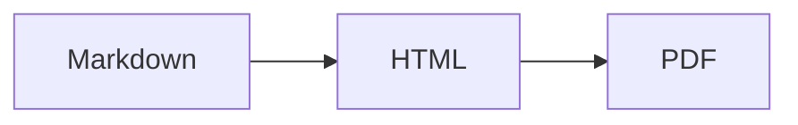

[toc]

# Markdown 导出 PDF 验证

中文与 English 内容应清晰可读，保留 **加粗**、*斜体* 和 [链接](https://github.com/Chihang03/vscode-office)。

## 表格与代码

| 项目 | 预期结果 |
| --- | --- |
| 中文 | 字形正常，无方框 |
| 表格 | 列宽正常，内容完整 |
| 图片 | 从 Markdown 相对路径加载 |

```javascript
const message = 'Markdown to PDF';
console.log(message);
```

## 数学公式与流程图

行内公式 $E = mc^2$，以及独立公式：

$$
\sum_{i=1}^{n} i = \frac{n(n+1)}{2}
$$



<div class="page"></div>

## 本地图片


## 检查清单

- [x] 中文、代码、表格、公式、流程图和图片
- [ ] 在 VS Code 中检查入口与保存对话框
